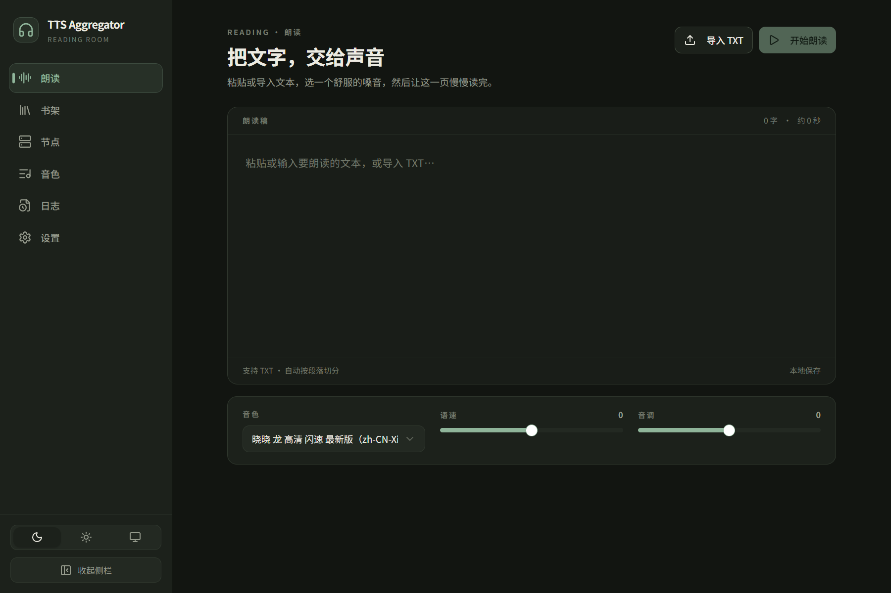
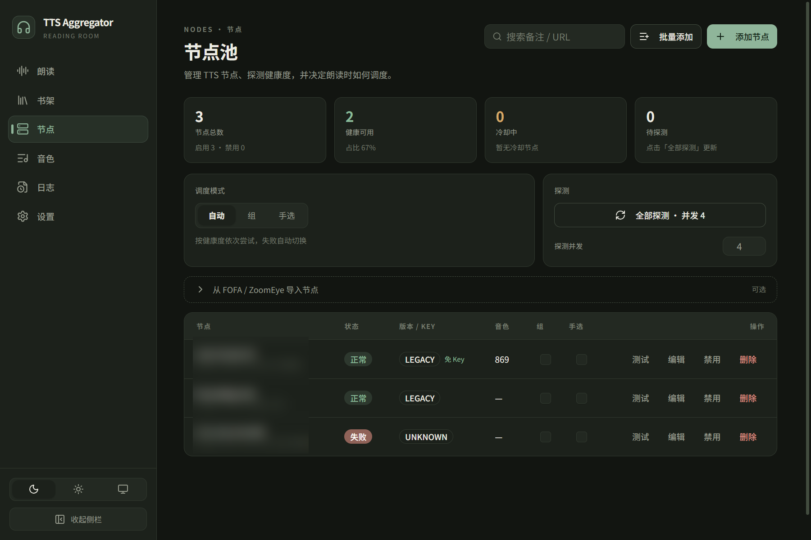
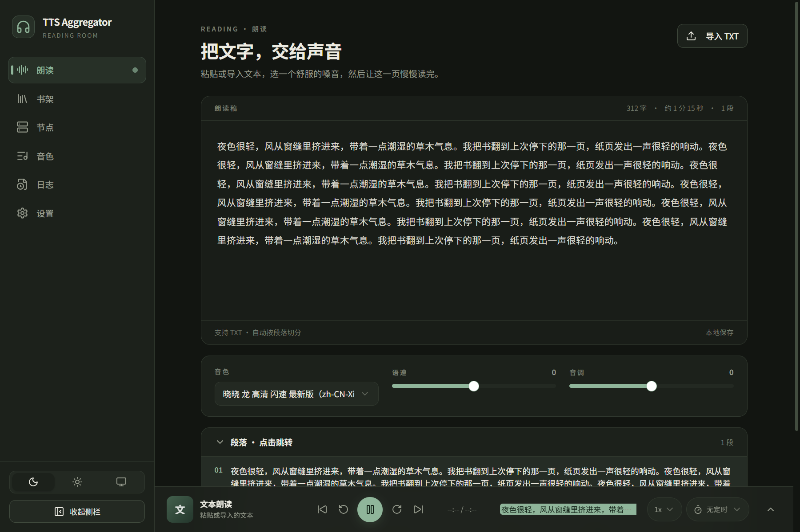
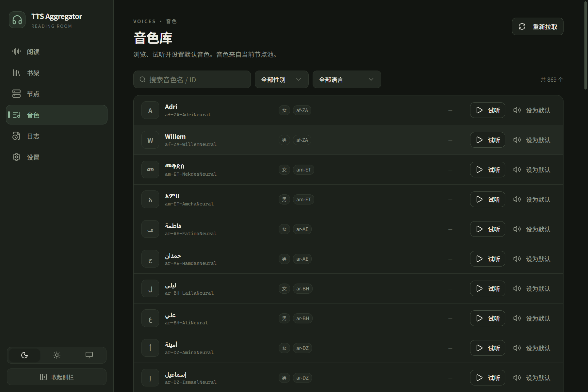
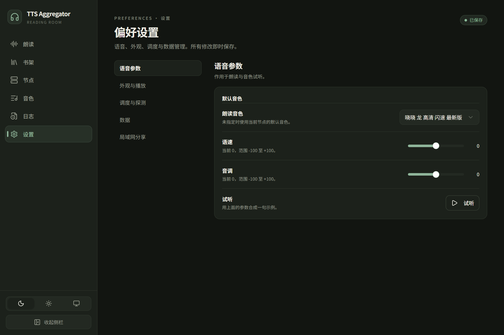

# Pulse 桌面端

**Pulse 桌面端**（仓库名 `tts-aggregator-desktop`）是 Pulse 的 Windows 客户端，基于 Tauri 2 + React + TypeScript + Vite。它与安卓版共用同一套节点协议：把多个自建 TTS 节点聚合成一个稳定的合成通道，自动挑选可用节点、失败自动切换，并在本机完成长文本朗读与小说听书。

<p align="center">
  
  
  
</p>

## 目录

- [功能特性](#功能特性)
- [界面截图](#界面截图)
- [工作原理](#工作原理)
- [节点接口要求](#节点接口要求)
- [快速开始](#快速开始)
- [使用说明](#使用说明)
- [权限说明](#权限说明)
- [项目结构](#项目结构)
- [与安卓版差异](#与安卓版差异)
- [常见问题](#常见问题)
- [隐私说明](#隐私说明)
- [已知限制](#已知限制)

## 功能特性

### 朗读与播放

- 粘贴或输入长文本，按段落与句号切分后逐段合成、排队播放，支持预合成下一段
- 播放控制：暂停 / 继续、快退 10 秒、快进 10 秒、上一段 / 下一段、音量与倍速即时调节
- 句级高亮随播放推进并自动滚动，显示实时字数与预计时长
- 睡眠定时（关闭 / 15 / 30 / 60 分钟）
- 支持系统媒体键，窗口最小化后仍可播放
- 导入本地 TXT（UTF-8，失败回退 gb18030），也可直接在文本框粘贴

### 节点池

- 添加任意数量的 TTS 节点，支持自定义名称、分组与 API Key
- 三种调度模式：
  - **自动**：按健康度与延迟排序，失败后自动切换到下一个节点
  - **按组**：仅使用轮询池中的节点，按顺序轮流调用
  - **手选**：固定使用某个节点，连续失败 3 次熔断
- 单个 / 全部节点探测，探测并发数可调（1–8）
- 连续失败达到阈值后进入冷却，冷却结束自动恢复；阈值与冷却时长可在设置中调整
- 自动识别两代 API 版本与免 Key 节点

### 音色

- 从节点拉取 `/api/v1/voices` 或 `/voices`，内置中文显示名映射
- 按性别、语言筛选，支持搜索、试听与设为默认
- 离线内置音色清单，节点不可用时仍可浏览

### 书架（小说听书）

- 导入本地 TXT 小说，自动解析多级目录：卷 / 篇 / 部、章 / 回 / 节 / 集，以及「1、」「1.」编号行
- 按卷分组展示章节树，支持点播任意章节
- 书 / 章 / 段三级断点续听，章末自动连播，全书播完提示
- 书级倍速覆盖，独立于全局播放设置

### 导入与迁移

- **FOFA**：CSV / JSON 文件导入，或配置 API 在线搜索
- **ZoomEye**：JSON 文件导入，或配置 API 在线搜索
- 按 TTS 关键词相关性排序，逐条勾选入库并保留来源
- 配置备份：通过原生文件对话框导出 / 导入 JSON（节点 + 音色 + 偏好），不含 API Key

### 局域网同步

- 与安卓端双向合并节点，mDNS（`_pulse-tts._tcp.local.`）自动发现同网段设备
- 二维码 / 配对串配对，可开启「自动允许同步请求」免确认
- 只同步节点地址、名称与分组，不传 API Key 与偏好设置
- 接收端按 URL 去重合并

### 记录与外观

- 记录每次合成的节点、耗时、尝试次数、失败原因与切换来源
- 按「全部 / 成功 / 失败 / 切换」筛选，可一键清空
- 深色 / 浅色 / 跟随系统三种主题，多套配色，窄窗口自动收起侧栏

## 界面截图

| 朗读 | 节点 | 播放器 |
| --- | --- | --- |
|  |  |  |

| 音色 | 设置 |
| --- | --- |
|  |  |

## 工作原理

```text
朗读页 / 书架 / 导入的 TXT
            │  切分段落与句子
            ▼
      NodePool（自动 / 按组 / 手选）
            │  健康检查、失败切换、冷却
            ▼
   TTS 节点 A ── TTS 节点 B ── TTS 节点 C
         （HTTP，返回音频字节）
            │  MP3 等音频
            ▼
   HTML5 Audio（blob URL）+ 播放器 Dock
```

- 每次合成结果转为 blob URL 交给 HTML5 Audio 播放，不做 PCM 解码
- 节点健康状态、连续失败次数与冷却时间随调用实时更新
- 文本只在本机与所选节点之间传输，不经过任何第三方服务
- 局域网同步由 Rust 侧内嵌 HTTP 服务处理：`GET /v1/ping` 交换设备与节点数量，`POST /v1/sync` 携带 `X-Sync-Session` 完成一次配对合并

## 节点接口要求

节点需要兼容以下 HTTP 接口（新老部署均可）：

| 用途 | 接口 | 说明 |
| --- | --- | --- |
| 健康检查 | `GET /api/v1/health` | 新版部署用于判定 V1 |
| 音色列表 | `GET /api/v1/voices` | 新版；老版回退到 `GET /voices` |
| 合成（新版） | `POST /api/v1/tts` | JSON：`text`、`voice`、`rate`、`pitch`、`style` |
| 合成（老版） | `POST /tts` | 字段与新版一致 |
| 合成（兼容） | `GET /tts?text=&t=&v=&r=&p=&s=` | 同时发送 `text` 与 `t` 以覆盖不同部署 |

- 需要鉴权的节点通过 `api_key` 查询参数传递
- 免 Key 节点会被自动识别，无需填写密钥
- 响应应为音频字节（MP3 等），空响应视为失败并触发重试或切换

## 快速开始

### 环境要求

| 项目 | 版本 |
| --- | --- |
| 操作系统 | Windows 10 及以上（x64） |
| Node.js | 18+（推荐 20+） |
| Rust | stable（rustup 安装） |
| MSVC | Visual Studio Build Tools（C++ 桌面开发） |
| WebView2 | Windows 10/11 通常已内置 |

### 安装与开发

```powershell
npm install
npm run tauri dev     # 开发模式，首次需编译 Rust，耗时较长
```

仅调试前端（无原生能力，节点请求会受限）：

```powershell
npm run dev
```

### 构建安装包

```powershell
npm run tauri build
```

产物位于 `src-tauri/target/release/bundle/`：

- `nsis/*-setup.exe`：NSIS 安装包（推荐）
- `msi/*.msi`：MSI 安装包

安装包未做代码签名，首次运行时 Windows SmartScreen 可能提示「已保护你的电脑」，选择「更多信息 → 仍要运行」即可。

### 运行测试

```powershell
npm test              # 等价 npx vitest run，纯函数单测
npx tsc --noEmit      # TypeScript 类型检查
cargo check --manifest-path src-tauri\Cargo.toml   # Rust 检查
```

### 发布版本（维护者）

版本号统一维护在 `package.json`、`src-tauri/Cargo.toml` 与 `src-tauri/tauri.conf.json`，由脚本同步改写：

```powershell
.\scripts\release.ps1 1.0.1         # 更新版本号、提交、打 tag 并推送
.\scripts\release.ps1 1.0.1 -NoPush # 只生成本地提交与 tag
```

推送 tag 后由 `.github/workflows/release.yml` 在 Windows runner 上运行测试、构建 NSIS 与 MSI，并按 `.github/cliff.toml` 生成分类变更记录、创建 GitHub Release。

> PowerShell 默认执行策略可能阻止脚本运行。可仅对本次进程放行：
> `powershell.exe -NoProfile -ExecutionPolicy Bypass -File .\scripts\release.ps1 1.0.1`

## 使用说明

1. **添加节点**：进入「节点」页，点击右上角 `+`，填写节点地址（如 `https://tts.example.com`），可选填名称、分组与 API Key。
2. **测试节点**：保存后自动探测；也可手动「测试连接」或「全部探测」。
3. **选择调度模式**：在「自动 / 按组 / 手选」之间切换，按需配置轮询池或固定节点。
4. **选择音色**：在朗读页点击音色入口，或进入「设置 → 默认声音」。
5. **开始朗读**：在朗读页粘贴文本或导入 TXT，点击开始；底部播放器支持倍速、跳转与睡眠定时。
6. **导入小说**：进入「书架」导入 TXT，解析目录后按章节收听，进度自动保存。
7. **导入节点**：在「节点 → 导入」中使用 FOFA / ZoomEye 文件或在线搜索，勾选后批量入库。
8. **局域网同步**：进入「设置 → 局域网同步」，启动服务后用安卓端扫码或粘贴配对串；也可在安卓端发起，桌面端确认后合并节点。
9. **备份配置**：进入「设置 → 数据」，导出 JSON 备份；导入时按 URL 去重并保留已有密钥。

## 权限说明

桌面端不申请 Android 式运行时权限，仅通过 Tauri capability 声明所需能力：

| 能力 | 用途 |
| --- | --- |
| `http`（任意 `http/https` 主机） | 访问用户填写的 TTS 节点与 FOFA / ZoomEye API |
| `dialog` 打开 / 保存 | 选择 TXT 与配置备份文件、导出备份 |
| `fs` 读写文本文件 | 读取导入的 TXT，写入导出的 JSON |
| `sql` | 读写本机 SQLite（节点、日志、设置、书籍、章节） |
| `opener` | 在系统浏览器中打开外部链接 |
| 局域网监听 | 同步期间绑定 `0.0.0.0` 的随机端口，并注册 mDNS 服务 |

应用不访问摄像头、麦克风、通讯录或剪贴板历史；不驻留后台服务，关闭窗口即退出（局域网同步随应用停止）。

## 项目结构

```text
src/
├── lib/            # 协议与纯逻辑
│   ├── api.ts          TTS 节点客户端（三级端点回退）
│   ├── pool.ts         调度器（AUTO/GROUP/MANUAL + 冷却 + 连败熔断）
│   ├── split.ts        长文本切分
│   ├── sentences.ts    句级切分与播放进度定位
│   ├── toc.ts          书籍目录解析
│   ├── encoding.ts     TXT 编码嗅探（UTF-8 → gb18030）
│   ├── db.ts           SQLite 仓库层（nodes/logs/settings/books/chapters）
│   ├── lanSync.ts      同步数据模型、配对串与节点合并
│   ├── configTransfer.ts  配置导入导出
│   └── importers/      FOFA / ZoomEye 解析与在线搜索
├── store/          # zustand 状态（节点 / 音色 / 日志 / 播放 / 设置 / 同步）
├── pages/          # 朗读、节点、音色、日志、设置、书架、书籍详情、导入面板
├── components/     # 播放器、设置分区、UI 基础组件
├── types/          # 数据模型（与安卓同构）
└── assets/         # 品牌图标等静态资源
src-tauri/
├── src/lib.rs      # 插件注册与局域网同步命令
├── src/lan_sync/   # 同步 HTTP 服务、mDNS、协议校验
├── icons/          # 应用图标（ico / icns / png）
└── tauri.conf.json # 应用名、版本、窗口与打包配置
docs/design/        # 设计规格
.github/workflows/  # 发布流水线（NSIS / MSI + Release）
scripts/            # 发版脚本
```

- 节点、日志、设置、书籍与章节统一存于本机 SQLite（`tts_desktop.db`），位于 Tauri 应用数据目录
- 界面使用 Tailwind CSS v4 + shadcn/ui 风格组件，图标来自 lucide-react

## 与安卓版差异

| 差异 | 说明 |
| --- | --- |
| 系统 TTS | 不支持。桌面程序无法注册为系统朗读引擎，朗读仅在应用内 |
| 播放实现 | HTML5 Audio + blob URL，节点返回 MP3 等可直接播放的格式；无 PCM 解码 |
| 文本导入 | 仅支持本地 TXT，不支持 EPUB |
| 扫码 | 桌面端展示二维码与配对串，自身不调用摄像头；扫安卓端二维码需用手机 |
| 更新 | 无应用内检查更新，需手动下载新版本安装包覆盖安装 |
| 通知 | 无系统通知与后台常驻，关闭窗口即停止播放 |

## 常见问题

**节点显示「冷却中」怎么办？**

连续失败达到阈值后节点会进入冷却。可在「设置 → 调度与探测」调整失败阈值与冷却时长，或在节点页手动测试连接。冷却结束会自动恢复。

**安装或启动时被 SmartScreen 拦截？**

安装包未做代码签名，属于预期行为。确认文件来自本仓库 Release 后，点击「更多信息 → 仍要运行」。也可用 Release 中提供的 SHA-256 校验安装包完整性。

**朗读没有声音？**

先确认节点测试通过、音色可用；再检查系统音量与输出设备。部分节点返回的音频格式 WebView2 无法直接播放时，表现为合成成功但无声音，可尝试切换节点或音色。

**局域网同步发现不到设备？**

确认两端在同一网段、桌面端同步服务已启动，并允许 Windows 防火墙放行应用。mDNS 在部分企业网络或开启 AP 隔离的路由器下不可用，此时改用二维码 / 配对串手动配对。

**同步会带走 API Key 吗？**

不会。同步只包含节点地址、名称与分组；API Key 与偏好设置保留在各自设备。

**导出的配置包含密钥吗？**

不包含。导出内容为节点、音色与偏好设置，API Key 不会写入导出文件。

**支持哪些节点服务？**

兼容提供 `/api/v1/tts`、`/tts` 或 `/voices` 的 HTTP TTS 服务，新老两代部署均可。

**数据存在哪里？如何彻底清空？**

节点、日志、书籍等存于本机 SQLite。可在「设置 → 数据」清空日志或恢复默认，也可退出应用后删除应用数据目录中的 `tts_desktop.db`。

## 隐私说明

- 朗读文本仅在本机与所选节点之间传输，不经过其他服务器
- API Key 仅保存在本机 SQLite 中，导出配置与局域网同步均不会包含
- 调用记录仅存于本机，可随时清空
- 导入的 TXT 与书籍内容只保存在本机，不上传
- FOFA / ZoomEye 查询仅在你主动配置并触发时发出

## 已知限制

- 仅提供 Windows 10+ x64 安装包，未提供 macOS / Linux 正式构建
- 安装包未签名，SmartScreen 会提示未知发布者
- 无系统 TTS 引擎能力，其他应用无法调用
- 无自动更新与后台常驻，关闭窗口即停止播放与同步
- 局域网同步依赖 mDNS，部分网络环境需手动配对
- 仅支持 TXT 文本，无 EPUB、PDF 等格式
